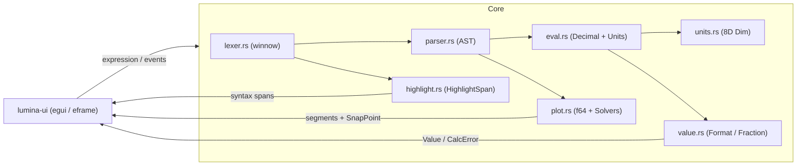

# LuminaCalc

**English** | [Русский](README.ru.md)

**LuminaCalc** is a fast, native desktop calculator built in Rust (`egui` / `eframe`) combining four calculation modes in a single lightweight window, with automatic Windows 11 system accent theming (Dark / Light) and bilingual UI (EN / RU).


[](https://github.com/H1rolce/LuminaCalc/releases/latest)

---

## Features

- **Notebook (Soulver / Numi style)** — reactive multi-line calculations with variables, line references (`#1`, `#2`), block aggregates (`sum`, `avg`), physical unit conversions (`120 km/h in m/s`, `22 °C in °F`), and radix/scientific conversions (`255 in hex`).
- **Scientific Calculator (Casio ClassWiz / fx-991ES PLUS style)** — interactive 2D Natural-V.P.A.M. display with multi-story fractions, balanced parentheses inside fractions (`((2+5)*2)/(3)`), mouse-clickable caret positioning, `SHIFT`, `HYP`, `DEG/RAD/GRAD`, `S⇔D`, `a b/c`, `ENG`, `CONST`, memory (`MC/MR/M-/M+/STO`), `Ans` chaining after `=`, automatic parenthesis closing, smart multi-token `DEL`, and persistent calculation history.
- **2D Function Plotter** — multi-curve plotting on `egui_plot`, auto-generated parameter sliders (`y = a * sin(b * x)`) with smooth animation, discontinuity/asymptote splitting (`1/x`, `tan(x)`), and magnetic cursor snapping to roots, extrema, Y-intercepts, and curve intersections.
- **Programmer & Unit Converter** — 64/32/16/8-bit register (`HEX`/`DEC`/`OCT`/`BIN`, signed/unsigned, bitwise ops, clickable & drag-paintable 64-bit grid) plus an engineering unit converter.
- **Desktop Integration** — live Windows accent color reading from the registry (`DWM\AccentColor`), debounced TOML state persistence, global summon hotkey (`Ctrl+Alt+Space`), always-on-top mode, and embedded multi-resolution `.exe` & taskbar icon.

---

## Download

Prebuilt portable Windows x64 binaries (`LuminaCalc.exe`) are available on the [**Latest Release**](https://github.com/H1rolce/LuminaCalc/releases/latest) page (see also [all releases](https://github.com/H1rolce/LuminaCalc/releases)). No installation required — download and run.

---

## Keyboard Shortcuts

| Shortcut | Action |
|---|---|
| `Ctrl+Alt+Space` | Global summon / focus window |
| `Ctrl+1` … `Ctrl+4` | Switch tabs (Notebook / Scientific / Plotter / Programmer) |
| `Ctrl++` / `Ctrl+-` | Increase / decrease Notebook font size |
| `S` / `Shift+S` / `Ctrl+S` | Scientific: `sin(` / `asin(` / `sinh(` (layout-independent) |
| `O` / `Shift+O` / `Ctrl+O` | Scientific: `cos(` / `acos(` / `cosh(` (layout-independent) |
| `T` / `Shift+T` / `Ctrl+T` | Scientific: `tan(` / `atan(` / `tanh(` (layout-independent) |
| `L` / `N` / `R` / `Q` / `P` / `E` / `Shift+E` / `D` | Scientific: `log(`, `ln(`, `√(`, `²`, `π`, `e`, `×10ˣ`, `S⇔D` |
| `F5` / `F6` / `F7` / `F8` | Programmer: switch `HEX` / `DEC` / `OCT` / `BIN` |
| `◀` `▶` `▲` `▼` `Tab` | Navigate expression, fractions, and history in Scientific mode |
| `Esc` | Clear expression / close `CONST` menu |

---

## Building from Source

Requires Rust (`edition = 2024`).

```bash
# Run the full workspace test suite
cargo test --workspace

# Run Clippy with warnings as errors
cargo clippy --workspace --all-targets -- -D warnings

# Optimized release build (-O3, fat LTO, single codegen-unit, strip)
cargo build --release -p lumina-ui
```

---

## Architecture

The project is structured as a **Cargo Workspace** with strict separation between the headless math engine and the GUI layer:

```text
LuminaCalc/
├── Cargo.toml                  # Workspace + release profile (-O3, fat LTO, strip)
├── LICENSE                     # MIT License
├── lumina-core/                # Headless calculation engine (zero GUI dependencies)
│   ├── src/
│   │   ├── lib.rs              # Public core facade
│   │   ├── error.rs            # CalcError, ErrorKind, ErrorCategory (Syntax vs Math), Span
│   │   ├── lexer.rs            # Zero-copy winnow lexer (EN/RU, 0x/0b/0o, °, ², ³, #ref)
│   │   ├── parser.rs           # Precedence-climbing parser, implicit mul, auto_close_parens
│   │   ├── eval.rs             # Exact Decimal evaluator + modular trigonometry
│   │   ├── units.rs            # Dimensional analysis (8D vector: 7 SI + Info) & unit table
│   │   ├── value.rs            # Value, UnitHint, formatters (Decimal/Sci/Radix/Eng/Fraction)
│   │   ├── highlight.rs        # Semantic token classification for syntax highlighting
│   │   ├── notebook.rs         # Reactive notebook engine with per-line AST caching
│   │   ├── plot.rs             # Fast f64 evaluator, curve sampler, root/intersection solvers
│   │   └── programmer.rs       # BitRegister (8/16/32/64-bit, signed/unsigned, shifts/rotates)
│   └── tests/
│       └── integration.rs      # End-to-end core integration tests
└── lumina-ui/                  # Desktop UI built on eframe / egui
    ├── build.rs                # Embeds multi-resolution icon.ico into Windows PE resources
    ├── assets/                 # icon.png (256x256), icon.ico (16..256px), icon.rc
    └── src/
        ├── main.rs             # eframe entry point, frameless viewport, window/taskbar icon
        ├── app.rs              # Root state, shortcuts, clipboard, debounced TOML persistence
        ├── state.rs            # AppState serialization/deserialization (state.toml)
        ├── style.rs            # Design system, Dark/Light palettes, fonts, LayoutJob highlighter
        ├── win_theme.rs        # Windows registry reader for system theme & AccentColor
        ├── titlebar.rs         # Custom titlebar, proportional tabs, 8-way frameless resize
        ├── toast.rs            # Lightweight foreground toast notifications
        ├── i18n.rs             # EN / RU localization & ErrorKind formatting
        ├── notebook_view.rs    # Two-column notebook view with LayoutJob & result caching
        ├── sci_view.rs         # Scientific calculator (6-column grid, CONST, Ans, smart DEL)
        ├── math_display.rs     # Interactive 2D Natural-V.P.A.M. parser, renderer & hit-tester
        ├── plot_view.rs        # Plotter UI, parameter sliders, PlotPoints::Borrowed cache
        └── prog_view.rs        # Interactive bit grid & cached engineering unit converter
```

### Data Flow



---

## Key Technical Highlights

### 1. Exact Arithmetic & Trigonometry (`lumina-core`)
- Core arithmetic uses 96-bit `rust_decimal::Decimal`, eliminating IEEE 754 representation artifacts (`0.1 + 0.2 = 0.3`).
- Transcendental functions compute in `f64` rounded to 15 significant digits. In `Deg` and `Grad` modes, angles are reduced modulo `360` / `400` in `Decimal` first: `sin(180°)` and `cos(90°)` are strictly `0`, while poles (`tan(90°)`, `tan(π/2)`, `cot(180°)`) return `ErrorKind::Domain` (`Math ERROR`).
- Negative zero (`-0`) is normalized away at the `Decimal` and formatting layers.
- Every error carries a byte `Span` and is classified via `ErrorCategory::{Syntax, Math}` — zero `.unwrap()` / `.expect()` on user input and no leaking `NaN`/`Infinity` in the UI.

### 2. Parser & Precedence (Casio ClassWiz)
- Precedence (low to high): `in`-conversion → `|` → `xor` → `&` → `<<`/`>>` → `+`/`-` → `*`/`/`/`mod`/`of`/`%` → implicit multiplication (`2(3+4)`, `(2+3)(4+5)`, `(2+3)2`, `2pi`, `3sin(30)`, `2Ans`, `1/2pi = 1/(2π)`) → unary `-`/`+`/`~` → `^` (right-associative: `2^3^2 = 512`, `-2^2 = -4`) → postfix `!`, `%`, `²`, `³` → primaries.
- `auto_close_parens` automatically balances trailing open parentheses on `=` in Scientific mode (`sin(30` → `sin(30)`).

### 3. Dimensional Analysis (`units.rs`)
- Physical dimensions are represented as a compact 8-byte exponent vector `Dim([i8; 8])` (length, mass, time, current, temperature, amount, luminous intensity, information in bits).
- Offset temperature scales (`°C`, `°F`) convert accurately through Kelvin without precision drift.

### 4. Interactive 2D Natural-V.P.A.M. Renderer (`math_display.rs` + `sci_view.rs`)
- A resilient 2D parser builds a spanned `MathNode` tree (`Frac`, `Sup`, `Sqrt`, `Paren`, `Slot`) even for incomplete expressions.
- Painting collects clickable `HitZone` rectangles and exact `CaretPos` geometry so users can click directly inside numerators, denominators, or between digits.
- The parsed `MathNode` tree is cached inside `ScientificView`, avoiding re-parsing on cursor blink ticks.

### 5. UI Performance & Caching
- **Notebook:** caches `LayoutJob` keyed by `(doc_version, theme, accent, font_size, wrap_width)` (avoiding stale glyph-atlas UVs) along with formatted result strings.
- **Plotter:** caches sampled curve segments and snap points by `(version, bounds)` and passes them via `PlotPoints::Borrowed` with zero per-frame copies.
- **Programmer:** caches unit converter evaluations by `(cat, from, to, val)`.
- **Idle Efficiency:** debounced TOML saves (`0.8s`) and toast notifications use `request_repaint_after` so idle CPU/GPU usage stays near zero.

---

## License

Licensed under the **MIT License**. See [LICENSE](LICENSE) for details.
