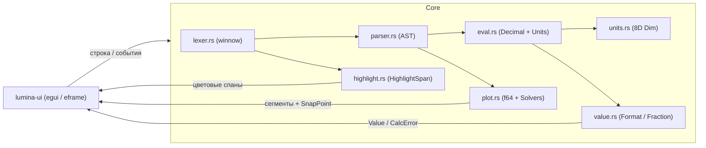

#  LuminaCalc

[English](README.md) | **Русский**

**LuminaCalc** — десктопный калькулятор на Rust (`egui` / `eframe`) для Windows и Linux. Приложение объединяет четыре режима расчётов в одном окне, поддерживает светлую и тёмную темы (на Windows используется системный акцентный цвет) и интерфейс на русском и английском языках.


[](https://github.com/H1rolce/LuminaCalc/releases/latest)

---

## Возможности

- **Блокнот (Soulver / Numi).** Многострочные вычисления с пересчётом при вводе: переменные, ссылки на строки (`#1`, `#2`), агрегаты по блоку (`sum`/`сумма`, `avg`/`среднее`), перевод физических величин (`120 км/ч в м/с`, `22 °C в °F`) и систем счисления (`255 в hex`).
- **Инженерный калькулятор (Casio ClassWiz / fx-991ES PLUS).** Интерактивный 2D Natural-V.P.A.M. дисплей с многоэтажными дробями, скобками внутри дробей (`((2+5)*2)/(3)`) и установкой курсора кликом мыши. Поддерживаются `SHIFT`, `HYP`, `DEG/RAD/GRAD`, `S⇔D`, `a b/c`, `ENG`, `CONST`, память (`MC/MR/M-/M+/STO`), цепочка вычислений через `Ans`, автозакрытие скобок по `=`, удаление целыми токенами по `DEL` и сохраняемая история.
- **Графики (2D Plotter).** Построение нескольких функций на `egui_plot`, автоматические ползунки для свободных параметров (`y = a * sin(b * x)`) с анимацией, разрыв на асимптотах (`1/x`, `tan(x)`) и прилипание курсора к корням, экстремумам, пересечениям с осью Y и между графиками.
- **Программист и конвертер единиц.** Регистр на 64, 32, 16 или 8 бит (`HEX`/`DEC`/`OCT`/`BIN`, знаковый и беззнаковый режимы, побитовые операции, 64-битная сетка с переключением кликом и протягиванием) и инженерный конвертер величин.
- **Интеграция с системой.** Поддержка Windows и Linux (Wayland и X11, `app_id = "luminacalc"` и `.desktop`-ярлык). На Windows читает системный акцент из `DWM\AccentColor`, сохраняет состояние в TOML, вызывается глобальным сочетанием `Ctrl+Alt+Space`, поддерживает режим поверх всех окон и поставляется со встроенными иконками.

---

## Скачать

Готовые сборки x86_64 для Windows и Linux доступны на странице [**Последнего релиза**](https://github.com/H1rolce/LuminaCalc/releases/latest) (см. также [все релизы](https://github.com/H1rolce/LuminaCalc/releases)):

- **Windows:** `LuminaCalc-windows-x86_64.zip` — портативный `LuminaCalc.exe`, распакуйте и запустите.
- **Linux (AppImage):** `LuminaCalc-linux-x86_64.AppImage` — автономный пакет без установки:
  ```bash
  chmod +x LuminaCalc-linux-x86_64.AppImage
  ./LuminaCalc-linux-x86_64.AppImage
  ```
- **Linux (tar.gz):** `LuminaCalc-linux-x86_64.tar.gz` — исполняемый файл `luminacalc`, ярлык `luminacalc.desktop` и иконка `luminacalc.png`.

---

## Горячие клавиши

| Сочетание | Действие |
|---|---|
| `Ctrl+Alt+Space` | Глобальный вызов / фокус окна (Windows / X11; в Wayland настройка выполняется через композитор) |
| `Ctrl+1` … `Ctrl+4` | Переключение вкладок (Блокнот / Инженерный / Графики / Программист) |
| `Ctrl++` / `Ctrl+-` | Увеличить / уменьшить шрифт в Блокноте |
| `S` / `Shift+S` / `Ctrl+S` | Инженерный: `sin(` / `asin(` / `sinh(` (независимо от раскладки) |
| `O` / `Shift+O` / `Ctrl+O` | Инженерный: `cos(` / `acos(` / `cosh(` (независимо от раскладки) |
| `T` / `Shift+T` / `Ctrl+T` | Инженерный: `tan(` / `atan(` / `tanh(` (независимо от раскладки) |
| `L` / `N` / `R` / `Q` / `P` / `E` / `Shift+E` / `D` | Инженерный: `log(`, `ln(`, `√(`, `²`, `π`, `e`, `×10ˣ`, `S⇔D` |
| `F5` / `F6` / `F7` / `F8` | Программист: переключение `HEX` / `DEC` / `OCT` / `BIN` |
| `◀` `▶` `▲` `▼` `Tab` | Навигация по выражению, дробям и истории в Инженерном режиме |
| `Esc` | Очистить выражение / закрыть меню `CONST` |

---

## Сборка из исходников

Требуется Rust (`edition = 2024`).

На **Linux (Ubuntu / Debian)** предварительно установите системные `-dev` пакеты:

```bash
sudo apt-get update
sudo apt-get install -y pkg-config libxkbcommon-dev libwayland-dev libx11-dev libxi-dev \
  libxcursor-dev libxrandr-dev libgl1-mesa-dev libfontconfig1-dev libgtk-3-dev \
  libxcb-render0-dev libxcb-shape0-dev libxcb-xfixes0-dev
```

Запуск тестов, линтера и релизной сборки:

```bash
# Запуск тестов всего workspace
cargo test --workspace

# Проверка линтером
cargo clippy --workspace --all-targets -- -D warnings

# Оптимизированная release-сборка (-O3, fat LTO, single codegen-unit, strip)
cargo build --release -p lumina-ui
```

---

## Архитектура проекта

В Cargo Workspace два крейта: математическое ядро (`lumina-core`) полностью отделено от интерфейса (`lumina-ui`).

```text
LuminaCalc/
├── Cargo.toml                  # Workspace + release-профиль (-O3, LTO fat, strip)
├── LICENSE                     # Лицензия MIT
├── lumina-core/                # Чистое математическое ядро (0 GUI-зависимостей)
│   ├── src/
│   │   ├── lib.rs              # Публичный фасад ядра
│   │   ├── error.rs            # CalcError, ErrorKind, ErrorCategory (Syntax vs Math), Span
│   │   ├── lexer.rs            # Zero-copy лексер на winnow (EN/RU, 0x/0b/0o, °, ², ³, #ref)
│   │   ├── parser.rs           # Precedence-climbing парсер, неявное умножение, auto_close_parens
│   │   ├── eval.rs             # Точный вычислитель на Decimal + модульная тригонометрия
│   │   ├── units.rs            # Размерностный анализ (8D-вектор: 7 SI + Info) и таблица единиц
│   │   ├── value.rs            # Value, UnitHint, форматирование (Decimal/Sci/Radix/Eng/Fraction)
│   │   ├── highlight.rs        # Семантическая классификация токенов для подсветки синтаксиса
│   │   ├── notebook.rs         # Реактивный движок блокнота с кэшированием AST по строкам
│   │   ├── plot.rs             # Быстрый f64-вычислитель, семплирование кривых, поиск корней/пересечений
│   │   └── programmer.rs       # BitRegister (8/16/32/64-bit, signed/unsigned, сдвиги, повороты)
│   └── tests/
│       └── integration.rs      # Интеграционные тесты ядра
└── lumina-ui/                  # Десктопный интерфейс на eframe / egui
    ├── build.rs                # Встраивание многоразмерной icon.ico на Windows
    ├── assets/                 # icon.png, icon.ico, icon.rc, luminacalc.desktop
    └── src/
        ├── main.rs             # Точка входа eframe, окно без рамок, иконка окна/панели задач
        ├── app.rs              # Корневое состояние, хоткеи, буфер обмена, дебаунс сохранения TOML
        ├── state.rs            # Сериализация/десериализация AppState в state.toml
        ├── style.rs            # Дизайн-система, генерация палитр Dark/Light, шрифты, подсветка LayoutJob
        ├── win_theme.rs        # Чтение системной темы и AccentColor из реестра Windows (advapi32)
        ├── titlebar.rs         # Кастомная шапка окна, пропорциональные вкладки, 8-сторонний ресайз
        ├── toast.rs            # Лёгкие всплывающие уведомления поверх UI
        ├── i18n.rs             # Локализация RU / EN и перевод ErrorKind
        ├── notebook_view.rs    # Двухколоночный редактор блокнота с кэшем LayoutJob и результатов
        ├── sci_view.rs         # Инженерный калькулятор (6-колоночная сетка, CONST, Ans, smart DEL)
        ├── math_display.rs     # Интерактивный 2D Natural-V.P.A.M. парсер, рендер и hit-testing
        ├── plot_view.rs        # Интерфейс плоттера, слайдеры параметров, кэш PlotPoints::Borrowed
        └── prog_view.rs        # Битовая сетка программиста и кэшируемый конвертер единиц
```

### Поток данных и разделение ответственности



---

## Технические детали

### 1. Точная арифметика и тригонометрия (`lumina-core`)
- Базовые операции выполняются в 96-битном `rust_decimal::Decimal`, без ошибок округления IEEE 754 (`0.1 + 0.2 = 0.3`).
- Трансцендентные функции вычисляются в `f64` с округлением до 15 значащих цифр. В режимах `Deg` и `Grad` угол предварительно приводится по модулю `360` или `400` в `Decimal`: `sin(180°)` и `cos(90°)` дают ровно `0`, а на полюсах (`tan(90°)`, `tan(π/2)`, `cot(180°)`) возвращается `ErrorKind::Domain` (`Math ERROR`).
- Отрицательный ноль (`-0`) нормализуется на уровне `Decimal` и при форматировании.
- Каждая ошибка хранит байтовый `Span` и категорию `ErrorCategory::{Syntax, Math}`. При обработке ввода пользователя не используются `.unwrap()` и `.expect()`, а `NaN` и `Infinity` не попадают в интерфейс.

### 2. Парсер и приоритеты (Casio ClassWiz)
- Приоритет от низшего к высшему: `in`-конвертация → `|` → `xor` → `&` → `<<`/`>>` → `+`/`-` → `*`/`/`/`mod`/`of`/`%` → неявное умножение (`2(3+4)`, `(2+3)(4+5)`, `(2+3)2`, `2pi`, `3sin(30)`, `2Ans`, `1/2pi = 1/(2π)`) → унарные `-`/`+`/`~` → `^` (правоассоциативная: `2^3^2 = 512`, `-2^2 = -4`) → постфиксные `!`, `%`, `²`, `³` → первичные выражения.
- В инженерном режиме `auto_close_parens` закрывает незакрытые скобки при нажатии `=` (`sin(30` → `sin(30)`).

### 3. Размерностный анализ (`units.rs`)
- Размерность хранится в 8-байтовом векторе степеней `Dim([i8; 8])` (длина, масса, время, ток, температура, количество вещества, сила света, информация в битах).
- Смещённые шкалы (`°C`, `°F`) переводятся через кельвины без накопления погрешности.

### 4. Интерактивный 2D Natural-V.P.A.M. рендер (`math_display.rs` + `sci_view.rs`)
- Отдельный парсер строит дерево `MathNode` (`Frac`, `Sup`, `Sqrt`, `Paren`, `Slot`) с точными байтовыми диапазонами даже для неполных выражений.
- При отрисовке собираются кликабельные области `HitZone` и позиция мигающего курсора `CaretPos`, что позволяет устанавливать курсор в числитель, знаменатель или между цифрами.
- Готовое дерево `MathNode` кэшируется в `ScientificView`, поэтому мигание курсора не вызывает повторный парсинг.

### 5. Кэширование UI и работа в простое
- **Блокнот:** кэширует `LayoutJob` по ключу `(doc_version, theme, accent, font_size, wrap_width)` (а не `Arc<Galley>`, чтобы избежать устаревших UV-координат после перепаковки атласа шрифтов) и отформатированные строки результатов.
- **Плоттер:** кэширует семплированные сегменты и точки прилипания по `(version, bounds)` и передаёт их в `egui_plot` через `PlotPoints::Borrowed` без копирования.
- **Программист:** кэширует результат конвертера единиц по `(cat, from, to, val)`.
- **Простой:** отложенная запись `state.toml` (`0.8s`) и тосты используют `request_repaint_after`, благодаря чему нагрузка на CPU и GPU в простое близка к нулю.

---

## Лицензия

Лицензия **MIT**. Подробности — в файле [LICENSE](LICENSE).
